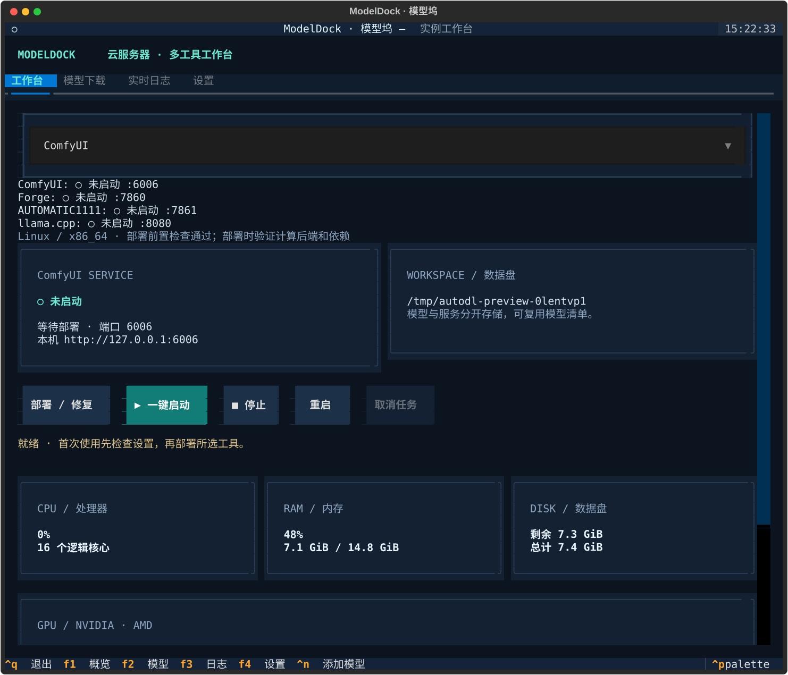

# ModelDock · 模型坞

在 Linux 云服务器内运行的中文 TUI，管理 **ComfyUI、Stable Diffusion WebUI Forge、AUTOMATIC1111、llama.cpp** 的部署、模型下载、后台服务、日志和资源占用。通过 SSH 登录服务器即可使用，无需云厂商 API；AutoDL 保留数据盘识别和访问提示。



## 快速启动

需要 Linux、Python 3.10+、git 和可写的数据目录。登录云服务器后直接执行，无需 FTP 上传：

```bash
curl -fsSL https://raw.githubusercontent.com/hwangzhun/ModelDock/main/install.sh -o /tmp/modeldock-install.sh && bash /tmp/modeldock-install.sh
```

安装器从 GitHub 获取源码，安装到 `~/.local/share/modeldock/app`，创建 `~/.local/bin/modeldock` 启动器并打开 TUI。下载脚本再运行可以保留终端标准输入；也支持 `curl -fsSL URL | bash`，脚本会重新连接 `/dev/tty`。

以后启动：

```bash
~/.local/bin/modeldock
# ~/.local/bin 已在 PATH 中时：
modeldock
```

显式更新到最新版本并启动：

```bash
bash /tmp/modeldock-install.sh --update
```

更多选项：

```bash
MODELDOCK_NETWORK=domestic bash /tmp/modeldock-install.sh --install-only
bash /tmp/modeldock-install.sh --ref main --update
bash /tmp/modeldock-install.sh --install-dir /data/modeldock -- --root /data/ai-models
```

已有安装默认复用，不在每次启动时更新源码。更新遇到本地修改会停止；源码和虚拟环境位于安装目录，模型工作目录与配置独立保存。失败的源码下载会清理临时目录，可重试。GitHub 不可达时可使用可访问的 Git 镜像：`MODELDOCK_REPO=仓库Git地址`，脚本本身也需要一个可访问的下载地址。远程仓库必须可访问；私有仓库需事先配置 Git 身份验证。

从本地源码开发时执行：

```bash
bash run.sh
```

首次安装选择 **国内加速** 或 **官方源**；选择会传给首次配置并保存。非交互运行需显式指定：

```bash
MODELDOCK_NETWORK=domestic bash run.sh
# 或
MODELDOCK_NETWORK=official bash run.sh
```

工具安装在本项目的 `.venv` 中。也可手动安装：

```bash
python3 -m venv .venv
.venv/bin/python -m pip install -e .
.venv/bin/modeldock
```

`ai-tui`、`autodl-tui`、`python -m modeldock` 和 `python -m autodl_tui` 继续可用。`MODELDOCK_PYTHON` / `MODELDOCK_PIP_INDEX` 可指定启动脚本的 Python 和 pip 源；旧变量 `AI_TUI_*` / `AUTODL_*` 继续支持，新变量优先。自定义 pip 源只控制 TUI 安装，不替代设置中的工具依赖源。

有 `/root/autodl-tmp` 时默认使用该数据盘，否则使用 `~/ai-workspace`。可覆盖：

```bash
bash run.sh --root /你的数据盘/ai
bash run.sh --config ~/my-ai-config.json
```

建议终端至少 100 × 36；80 × 24 也支持滚动操作。

## 部署和运行

1. 在工作台选择工具，查看环境检查结果。
2. 在设置检查全局数据盘、下载源和当前工具的 Python、安装目录、后端及端口，保存设置。
3. 点击“部署 / 修复”。首次下载源码并安装依赖；再次执行修复依赖，不自动更新或覆盖已有源码。
4. 下载适用的模型；llama.cpp 需要填写已有 GGUF 路径，或从下载模型列表选择。
5. 点击启动，根据访问提示打开浏览器或创建 SSH 隧道。日志页显示当前工具的运行或部署日志。

| 工具 | 默认端口 | 环境和部署方式 |
| --- | --- | --- |
| ComfyUI | 6006 | Python 3.10+；独立 venv，基础环境 PyTorch 经后端检查后复用 |
| Forge | 7860 | 独立 Python 3.10 venv；上游 `launch.py --exit` 准备依赖 |
| AUTOMATIC1111 | 7861 | 独立 Python 3.10 venv；上游 `launch.py --exit` 准备依赖 |
| llama.cpp | 8080 | CMake、C++ 编译器；构建 `llama-server` |

TUI 使用的 Python 与工具的 Python 可以不同。WebUI 的版本要求不同，不把 ComfyUI 的环境直接用于 WebUI。Forge 对应 PyTorch 2.3.1 / torchvision 0.18.1，A1111 对应 2.1.2 / 0.16.2；上游版本改变后需更新适配器并重新验证。

四种工具可同时运行，配置、日志和进程记录各自独立；每种工具首版管理一个实例。操作任务串行执行，其他已启动服务继续运行。多个模型同时运行会占用更多显存，内存不足时查看运行日志。

- 退出 TUI 或断开 SSH 后，服务仍运行；重启机器后不会自动启动。
- 重开同一工作目录可接管本工具启动的进程；PID、创建时间和完整命令均须匹配。
- 停止只作用于受管理的服务及其子进程。不会按端口查杀外部进程。
- 状态区显示四个工具的未启动、启动中、就绪、失败或外部服务状态。
- 修改当前工具设置前需停止该工具；修改全局设置前需停止全部受管理服务并暂停下载。
- 工作目录不自动搬迁模型或源码，安装目录也不会被覆盖。

## NVIDIA、AMD 和 CPU

计算后端可设为 `auto`、`cuda`、`hip`、`cpu`。

- Python 工具自动模式根据设备检测选择 CUDA、ROCm 或 CPU，部署时实际探测 PyTorch 后端。
- llama.cpp 自动模式根据可用的 `nvcc` / `hipcc` 选择 CUDA / HIP，否则 CPU。显式选择 GPU 后端时缺少工具链会报告错误，不静默切换。
- ROCm Python 部署需提供与 GPU、ROCm 和工具版本匹配的 **PyTorch wheel 源**，或为 ComfyUI 指定已配置好 ROCm PyTorch 的基础 Python。AMD 不自动启用 xformers 等 CUDA 专用选项。
- llama.cpp 的 GPU 卸载层数默认 `0`，即 CPU 推理；要使用构建的 GPU 后端，请设置适当层数或 `-1`。上下文默认 4096，分片 GGUF 选择第一片并下载其余分片。
- 缺少驱动、ROCm/CUDA、合适 Python、CMake 或编译器时，按界面检测结果补齐。工具不自动安装系统包、升级驱动或替换系统 Python。
- NVIDIA 指标通过 `nvidia-smi`，AMD 指标通过 `rocm-smi` 获取；工具缺失、权限不足或指标不可用时显示原因，其余功能仍可用。

上游参考：[ComfyUI 手动安装](https://docs.comfy.org/installation/manual_install)、[Forge 源码和安装脚本](https://github.com/lllyasviel/stable-diffusion-webui-forge)、[A1111](https://github.com/AUTOMATIC1111/stable-diffusion-webui)、[llama.cpp 构建](https://github.com/ggml-org/llama.cpp/blob/master/docs/build.md)。硬件兼容性取决于上游工具、驱动及依赖版本。

## 网络和访问

国内方案使用 GH-Proxy、HF-Mirror 和清华 PyPI；官方方案使用对应工具的官方 GitHub 仓库、Hugging Face 和 PyPI。每个工具设置独立仓库与备用地址，失败只尝试已配置备用源；取消不会触发备用下载。WebUI 上游准备步骤还会下载辅助仓库及包，其硬编码地址可能需要服务器能访问官方站点；主仓库加速不代表所有依赖均已加速。

国内镜像可用性因服务器网络而异，设置可替换为可访问的可信入口；预设填入后保存才生效。`torch_index` 专门控制 PyTorch wheel 源，不根据 GPU 名称猜测 ROCm 版本。

默认监听 `0.0.0.0`，允许平台端口映射。也可设为 `127.0.0.1`，在本地执行：

```bash
ssh -N -L 6006:127.0.0.1:6006 用户@服务器 -p SSH端口
```

访问 `http://127.0.0.1:6006`，其他工具替换端口。llama.cpp API 地址为 `http://127.0.0.1:8080/v1`。AutoDL 6006/6008 的映射见[平台端口说明](https://www.autodl.com/docs/port/)。公网访问使用平台的访问保护或服务自身认证；TUI 不额外提供服务登录认证。

## 模型库与下载

模型独立于源码存放在 `models/分类/文件名`。ComfyUI 通过额外模型路径 YAML 使用模型；Forge/A1111 通过路径参数共享 checkpoints、vae、loras、embeddings。GGUF 独立存放在 `models/gguf`。共享路径不会让不同工具自动兼容所有模型格式或工作流，也不会覆盖用户已有模型目录。

支持 Hugging Face、公开 ModelScope、Civitai 和 HTTP(S) 直链。HF / ModelScope 填写仓库 ID、文件路径及可选 revision；分片文件逐个加入清单。HF `/blob/` 链接可转换为下载地址；其他站点不解析分享页。

- 串行下载、暂停、重试、队列持久化，以及 Range / If-Range 断点续传。
- `.part` 文件保留续传；服务器不支持安全续传时重新下载。
- SHA256 可选，校验通过才生成最终文件；已有同名文件不覆盖。
- 导入清单不会立即下载；导出继续使用 version 1 格式，兼容原 SDXL 清单。
- 移出清单不删除模型和临时文件。分片 GGUF 需要完整下载所有分片。
- HF/Civitai 令牌只在当前会话或环境变量中使用，不写入配置；HF 令牌不发送给镜像。清单保留原 URL，不要在 URL 参数中存放密钥。

示例：[SDXL](examples/models-manifest.json)、[GGUF](examples/gguf-manifest.json)。

## 配置与旧版本兼容

新配置为 `~/.config/modeldock/config.json`，遵循 `XDG_CONFIG_HOME`。若新配置不存在，依次查找 `~/.config/ai-tui/config.json` 和 `~/.config/autodl-tui/config.json`，备份为 `.json.v1.bak` 后保存新版配置。显式 `--config` 使用指定文件；旧格式保存前同样备份。

新版配置包含 `version: 2`、全局下载设置及 `tools` 字典。原顶层 `python` / `repo` / `port` 等字段保留为 ComfyUI 配置，其他工具使用 `tools.forge`、`tools.a1111`、`tools.llamacpp`；旧字段和旧安装目录保持有效。

```text
工作目录/
├── ComfyUI/                    # 各 Python 工具有独立 .venv
├── Forge/
├── AUTOMATIC1111/
├── llama.cpp/build/bin/llama-server
├── models/                     # 共享分类 + gguf
└── .autodl-tui/                # 为兼容保留状态目录名
    ├── downloads.json
    ├── service.json            # 原 ComfyUI 进程身份，可继续接管
    ├── model-paths.yaml
    ├── operations.log
    ├── comfyui.log
    └── tools/
        ├── forge/              # service.json、operations.log、runtime.log
        ├── a1111/
        └── llamacpp/
```

每个工作目录只能运行一个 TUI 写入队列。操作日志超过 5 MiB 轮转；运行日志在下次启动时超过 10 MiB 则轮转，持续运行期间不截断。退出 TUI 暂停下载，部署任务需取消或等待完成。

快捷键：F1 工作台、F2 模型、F3 日志、F4 设置、Ctrl+N 添加模型、Ctrl+Q 退出。

## 开发验证与实测范围

```bash
.venv/bin/python -m pip install -e '.[dev]'
.venv/bin/python -m pytest -q
.venv/bin/ruff check .
.venv/bin/python scripts/render_preview.py
```

自动化测试使用临时目录、模拟 HTTP、真实小型测试服务进程和 Textual 无界面交互。验证配置迁移、路径共享、GGUF 选择、后端构建命令、下载安全，以及两个服务同时运行、重开接管、停止隔离。

| 环境 | 验证状态 |
| --- | --- |
| 本机 Linux x86_64 / Python 3.14，TUI 与双服务进程管理 | 已自动化验证；服务为测试 HTTP 进程 |
| 四工具完整安装与真实 CPU 推理 | 待真实环境验证 |
| NVIDIA CUDA：四工具部署与最小推理 | 待 GPU 实测 |
| AMD ROCm：四工具部署与最小推理 | 待 GPU 实测 |
| AutoDL / 其他云厂商端口映射 | 待对应平台实测 |

本次开发机器没有 NVIDIA/AMD GPU，且缺少 CMake/C++ 工具链；不将模拟测试视为实际模型推理验证。真实验收时，对每个工具执行一次最小推理，确认两个服务并行运行、退出后接管、单服务停止不影响另一服务，并记录 GPU、驱动、Python 和源码提交版本。
